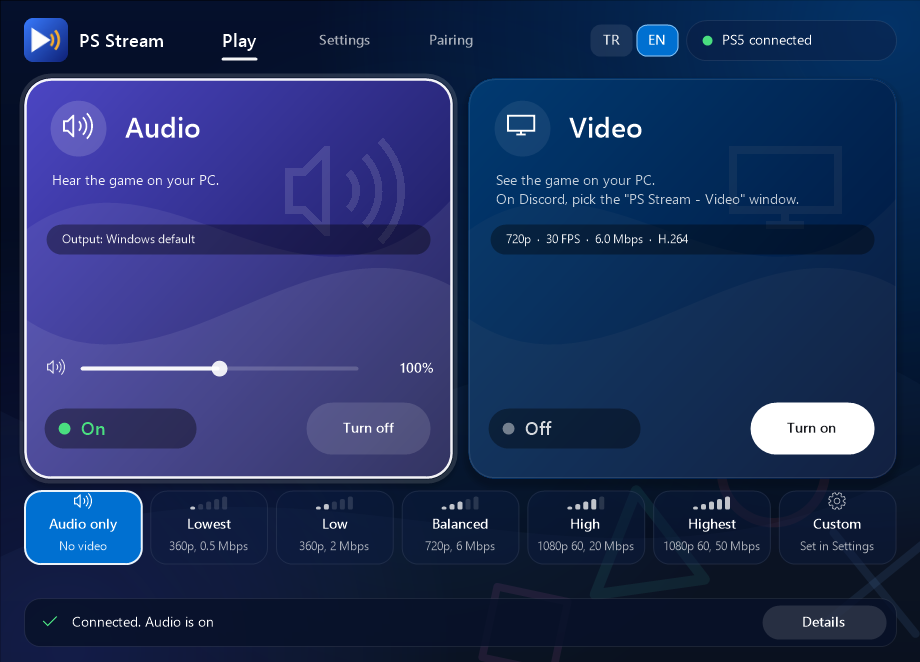
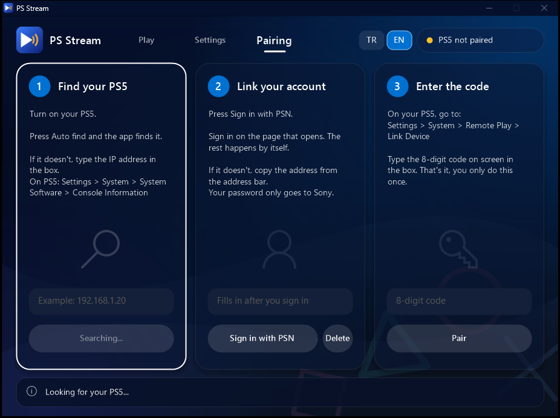
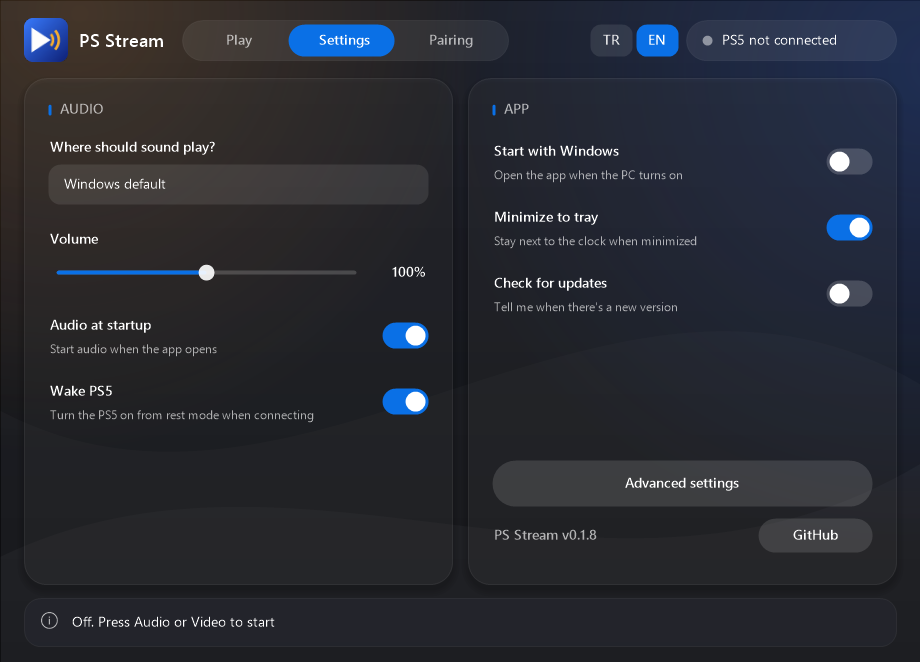

<p align="center">
  
</p>

<h1 align="center">PS Stream</h1>

<p align="center">
  A PS5 Remote Play client for Windows that lets you turn audio and video on and off separately.<br>
  Play on your TV and hear the game on your PC, or stream it to Discord.
</p>

<p align="center">
  <a href="../../releases/latest"><b>Download for Windows</b></a>
</p>



## Why

If you play on a TV and use Discord on your PC, the usual way to get game audio on the PC is to run a full Remote Play client. That wastes CPU and Wi-Fi on a video you never watch. PS Stream can skip the video.

## Features

- **Audio-only mode.** Video isn't decoded, and the PS5 is asked for the smallest stream.
- **Video on demand.** Turn video on when you want to stream to Discord, and pick the "PS Stream - Video" window there. Press `F11` in that window for full screen. Turning video on or off reconnects, which takes a few seconds.
- **Simple by default.** Two big buttons, and five quality presets from 360p at 0.5 Mbps to 1080p 60 FPS at 50 Mbps. To set resolution, frame rate, bitrate and codec yourself, use **Custom** or **Advanced settings**.
- **Built for Wi-Fi.** Pauses Windows' background Wi-Fi scans while connected, uses an audio buffer that adapts to jitter, and keeps your PC awake.
- **Audio controls.** Choose the output device and maximum delay, and change the volume right on the Play page.
- **Live connection numbers.** Press **Details** to see connection time, ping, audio dropouts, video frame rate and lost frames.
- **Connects by itself.** Checks for the PS5 about once a second and connects as soon as it answers. If the PS5 is in rest mode, the app sends it a wake-up signal. You can turn that off with **Wake PS5** in Settings. It also finds the console again if the router gives it a new address.
- **Runs in the background.** Minimizes to the tray, can start with Windows, remembers where its windows were, and opening it a second time shows the running copy.
- **Global hotkeys.** `Ctrl+Alt+F9` for audio and `Ctrl+Alt+F10` for video. You can change them.
- **Turkish and English interface.**

## Getting started

You need Windows 10 or 11 (64-bit), a PS5 on the same network, and a web browser for signing in.

1. Download the latest zip from [Releases](../../releases/latest) and extract it.
2. Open `PS Stream.exe`. Keep the folder together, because the app needs the files in `dist`. Windows may warn you because the app isn't signed. Choose **More info**, then **Run anyway**.
3. On the **Pairing** page:
   - The app looks for your PS5. If it can't find it, type the console's IP address.
   - Press **Sign in with PSN** and sign in on Sony's page in your browser. Your password goes only to Sony. While it waits, the app checks your browser's address bar and clipboard for Sony's redirect address, and links your account when it appears. If it doesn't link, copy the address from the address bar.
   - On the PS5, go to **Settings > System > Remote Play > Link Device** and type the 8-digit code into the app. Pairing starts by itself.
4. Press **Turn on** under **Audio** or **Video**.

You only pair once. After that, audio starts when you open the app, and you can turn video on whenever you need it. To choose yourself each time, turn off **Audio at startup** in Settings.



## Keeping your DualSense on the PS5

> **Not working yet.** Keeping the DualSense on the PS5 while connected with the account you're playing on doesn't work in this version. Support is planned for a future update.

Until then, pair the app with a **second PSN account** on the console, and your DualSense keeps working on the PS5. You don't need a controller on the PC.

The **DualSense on PS5** setting under **Advanced settings** stops the app from announcing a virtual controller, but this doesn't fix the problem on its own. It's on by default. Turn it off if connecting fails.

## Settings



The PS5 address and account ID stay saved until you delete them. To use another account, press **Delete** on the Pairing page, sign in again and pair. Settings, pairing data and a log are stored in `%APPDATA%\PSStream`. The log (`log.txt`) is the first place to look if something goes wrong, and **Open logs** in Settings takes you there.

For the best results on Wi-Fi, connect the PS5 to your router with a cable, or use 5 GHz. If the picture breaks up, lower the quality to **Balanced** or **Low**.

## Updates

At startup, the app asks GitHub for the latest release number, and shows an **Update** button if there is a newer one. That check sends no account or console data. Nothing is downloaded until you press the button.

When you press it, the app downloads the release from GitHub, checks it against the checksum GitHub lists for that file, replaces its files and restarts. Your pairing and settings stay as they are. If the new version doesn't start, the old files go back. Turn off **Check for updates** in Settings to stop the check.

## Known limitations

- Windows only.
- Waking the PS5 needs the console's option to turn on over the network, and hasn't been tested on a real console yet.
- Local network only.
- No controller input from the PC. The app is for audio and video.
- The PS5 sends some video even in audio-only mode, so the network use doesn't reach zero.
- 360p is the lowest resolution. A PS5 refused 144p when tested.
- Rates below 2 Mbps are outside what chiaki-ng offers. If the console refuses one, the app falls back to 2 Mbps.

## Is it safe for my account?

This is an unofficial client, and Sony doesn't support it. It connects the same way as other open-source Remote Play clients such as chiaki-ng, and it doesn't modify your console or games. I don't know of any account bans caused by this, but I can't promise there is no risk, and using unofficial clients may conflict with PlayStation Network's terms. Use it at your own risk.

## Building from source

Install [MSYS2](https://www.msys2.org/) to `C:\msys64`, then install the packages from a MINGW64 shell:

```bash
pacman -S --needed make mingw-w64-x86_64-gcc mingw-w64-x86_64-cmake mingw-w64-x86_64-ninja mingw-w64-x86_64-pkgconf mingw-w64-x86_64-curl mingw-w64-x86_64-json-c mingw-w64-x86_64-libevent mingw-w64-x86_64-miniupnpc mingw-w64-x86_64-openssl mingw-w64-x86_64-opus mingw-w64-x86_64-protobuf mingw-w64-x86_64-python mingw-w64-x86_64-python-protobuf mingw-w64-x86_64-SDL2 mingw-w64-x86_64-ffmpeg mingw-w64-x86_64-speexdsp
```

With [Git](https://git-scm.com/) on your `PATH`, run `build.cmd`. It downloads chiaki-ng v1.10.0, applies `patches/chiaki-ps-stream.patch` and builds the app.

## Credits and license

PS Stream is built on [chiaki-ng](https://github.com/chiaki-ng/chiaki-ng)'s Remote Play library. It also uses SDL2, FFmpeg, Opus, OpenSSL, curl and json-c.

Licensed under the [GNU AGPL v3 with the OpenSSL exception](LICENSE), the same license as chiaki-ng.

PS Stream isn't affiliated with or endorsed by Sony Interactive Entertainment. PlayStation, PS5 and DualSense are trademarks of Sony Interactive Entertainment Inc.
